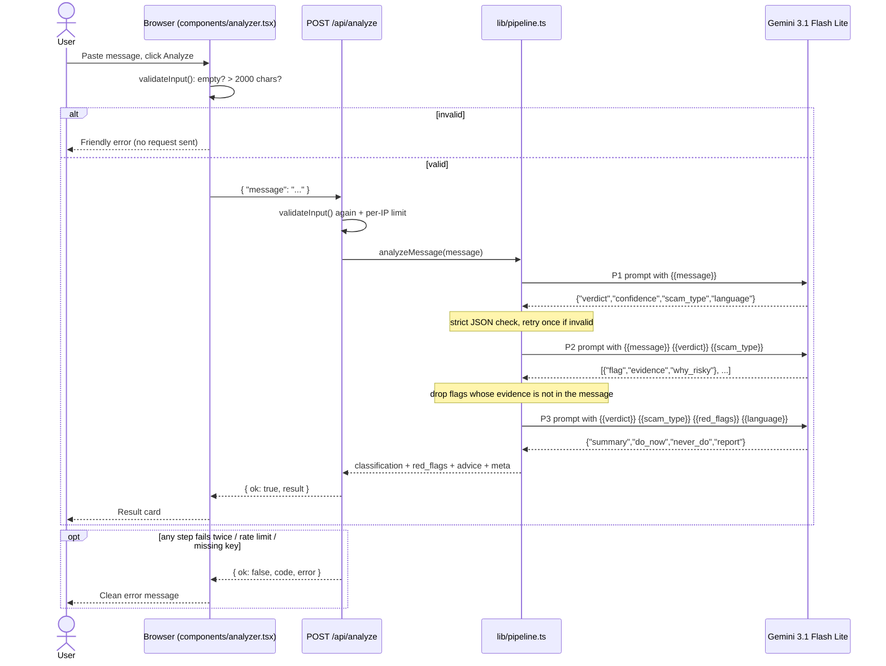

# Input → output flow

What the user sends, what each stage receives and returns, and what comes back to the browser.



## Example

**Input**

```json
{ "message": "Priya grahak, aapka KYC expire ho gaya hai, turant link pe click karo ..." }
```

**Output** (shape; real outputs are saved in `test-data/outputs/final.json`)

```json
{
  "ok": true,
  "result": {
    "classification": { "verdict": "scam", "confidence": 95, "scam_type": "fake_kyc", "language": "hinglish" },
    "red_flags": [
      { "flag": "...", "evidence": "turant link pe click karo", "why_risky": "..." }
    ],
    "advice": { "summary": "...", "do_now": ["..."], "never_do": ["..."], "report": "..." },
    "meta": { "model": "gemini-3.1-flash-lite", "total_ms": 0, "ungrounded_flags_removed": 0, "attempts": { "P1": 1, "P2": 1, "P3": 1 } }
  }
}
```
