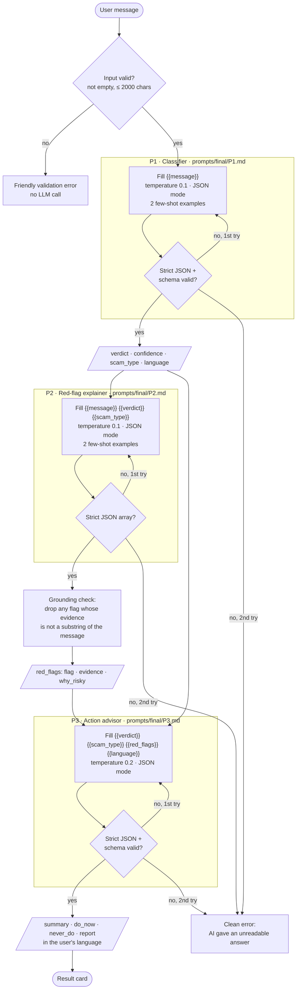
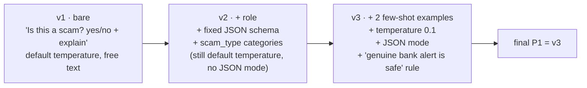

# Prompt workflow

How one message flows through the three chained prompts. Each step's JSON output becomes input variables for the next prompt. Every step is validated strictly and retried once if the model's output is not valid JSON.

## P1 iteration history

Measured results for each version are in [`../test-data/results-summary.md`](../test-data/results-summary.md).
