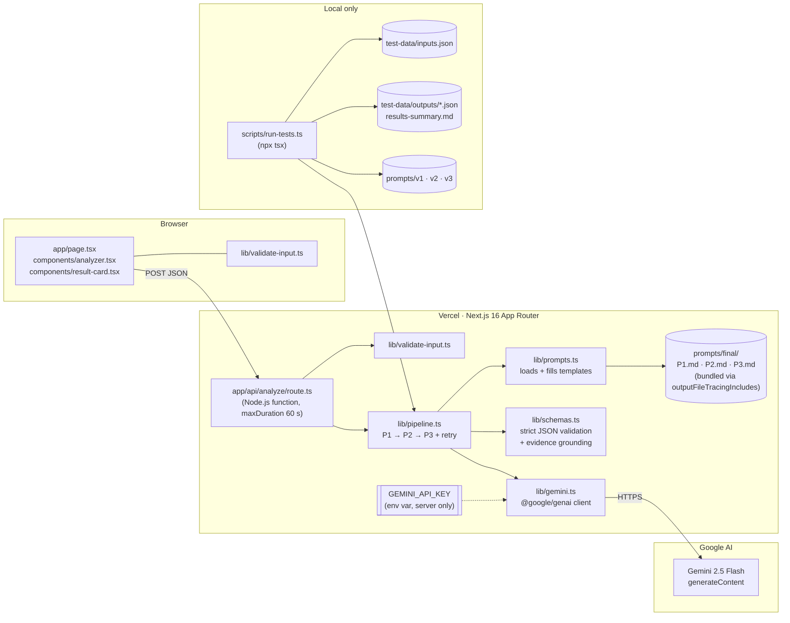

# System architecture

## Key decisions

- **The API key never reaches the browser.** Only the server route calls Gemini, and the key is read from `process.env.GEMINI_API_KEY`.
- **Prompts are files, not strings in code.** `lib/prompts.ts` reads `prompts/final/*.md` at runtime, and the frontmatter holds temperature, JSON mode and thinking budget. `next.config.ts` → `outputFileTracingIncludes` makes Vercel bundle these files with the function.
- **No database and no login.** Messages are not stored. The only server state is an in-memory, per-instance rate limit (8 requests per minute per IP).
- **The app lives at the repo root** so Vercel deploys it with zero configuration. `code/README.md` points to the source folders.
