# Task decomposition

The big task, "tell a non-expert whether a message is a scam and what to do", is split into three smaller jobs, so each prompt does one thing well and can be tested on its own.

```mermaid
flowchart TD
    ROOT["Is this message a UPI / KYC / banking scam,<br/>why, and what should I do?"]

    ROOT --> T0["0 · Guard the input<br/>(code, no LLM)"]
    ROOT --> T1["1 · Decide<br/>P1 Classifier"]
    ROOT --> T2["2 · Explain<br/>P2 Red-flag explainer"]
    ROOT --> T3["3 · Advise<br/>P3 Action advisor"]
    ROOT --> T4["4 · Present<br/>Web UI"]

    T0 --> T0a[Reject empty input]
    T0 --> T0b[Reject > 2000 characters]

    T1 --> T1a["verdict: scam / suspicious / safe"]
    T1 --> T1b["confidence 0–100"]
    T1 --> T1c["scam_type (9 categories)"]
    T1 --> T1d["language: en / hi / hinglish"]

    T2 --> T2a["Quote exact evidence from the message"]
    T2 --> T2b["One-sentence 'why risky'"]
    T2 --> T2c["Return [] when safe"]
    T2 --> T2d["Code drops any unquoted (invented) flag"]

    T3 --> T3a["1–2 sentence summary"]
    T3 --> T3b["do_now steps"]
    T3 --> T3c["never_do steps"]
    T3 --> T3d["report: cybercrime.gov.in / 1930 when relevant"]
    T3 --> T3e["Reply in the user's language"]

    T4 --> T4a[Verdict badge + confidence]
    T4 --> T4b[Highlighted evidence]
    T4 --> T4c[Do / don't lists]
    T4 --> T4d[Loading + error states]
```

| Sub-task | Who does it | Why separate |
|---|---|---|
| Input guard | TypeScript (`lib/validate-input.ts`) | Deterministic, free, and no point paying for an LLM call on empty or huge input |
| Classify | P1 | Narrow output (4 fields), low temperature, easy to measure accuracy and consistency |
| Explain | P2 | Needs the message text plus the verdict; the "quote exactly" rule is checkable in code |
| Advise | P3 | Doesn't need the raw message (so it can't repeat a scam link); only needs verdict, type, flags and language |
| Present | React (`components/`) | Pure UI |
